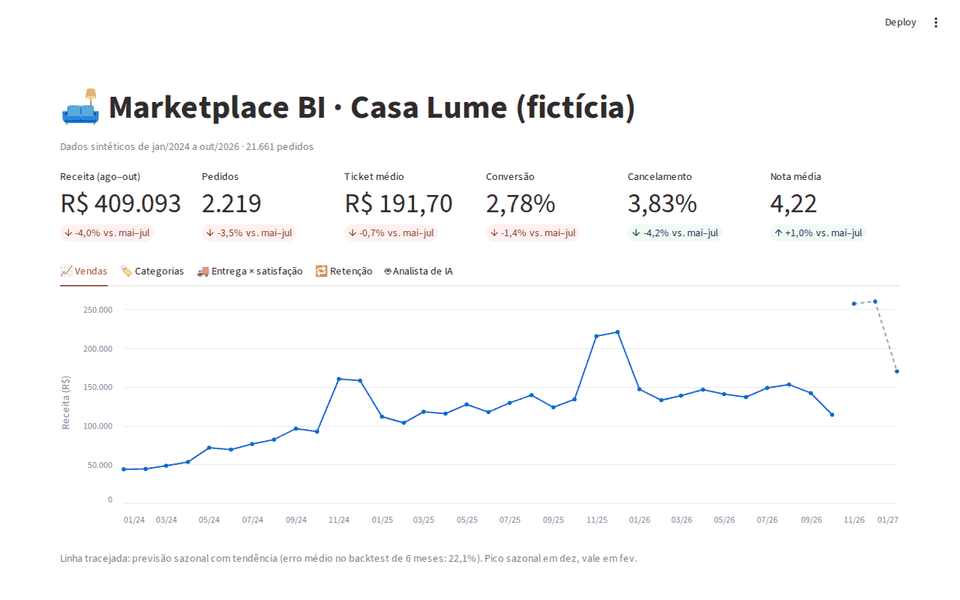
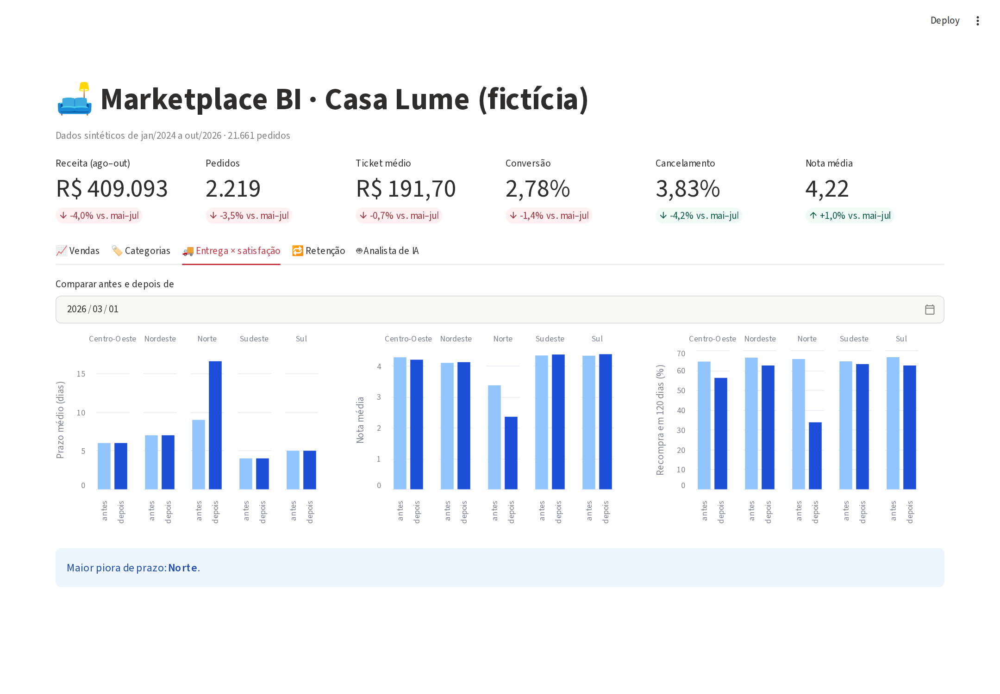

# 🛋️ Marketplace Business Intelligence: análises verificáveis + analista de IA

**BI completo de um marketplace fictício de casa e decoração: KPIs, tendências de categoria, entrega × satisfação, coortes, churn, sazonalidade, previsão e um analista de IA que responde perguntas da diretoria usando ferramentas de análise e SQL somente leitura.**



## A ideia central: dados com gabarito

Uma IA que "encontra insights" só é útil se os insights forem verdadeiros. Por isso, os dados sintéticos têm **padrões plantados de propósito** ([`padroes_plantados.json`](data/padroes_plantados.json)), e os testes verificam se as análises encontram exatamente esses padrões, sem inventar outros:

| Padrão plantado | O que a análise encontrou |
|---|---|
| Luminárias perdem demanda desde mai/2026 | queda de participação de 3,4% ao mês (t = −2,81) |
| Têxteis crescem de forma constante | alta de 3,0% ao mês (t = 6,77) |
| Norte com entregas mais lentas desde mar/2026 | prazo de 9,0 → 16,6 dias, nota de 3,37 → 2,35, recompra em 120 dias de 65,7% → 33,8% |
| Black Friday e Natal | novembro e dezembro são os dois maiores índices sazonais |
| (nenhum outro) | nenhuma outra categoria marcada como tendência |



### O que deu errado no caminho (e por que isso importa)

1. **Meu gabarito estava errado.** A primeira versão do gerador dizia "pico em novembro", mas novembro saiu *abaixo* da média: a "promoção" só encurtava o intervalo até a compra seguinte, e o desconto reduzia a receita. A análise de sazonalidade revelou o erro, eu corrigi o gerador, e agora um teste garante que o gabarito e os dados concordam.
2. **Tendência absoluta engana.** Medindo a receita em reais, Decoração aparecia em queda (não foi plantado) e o crescimento de Têxteis sumia: o mercado inteiro oscilava. Passei a classificar pela **participação na receita**, que separa o efeito da categoria do efeito do mercado.
3. **Ruído parece tendência.** Com janela de 6 meses, Banho aparecia como "queda". Agora uma categoria só é classificada se a tendência for relevante (≥ 2% ao mês) **e** estatisticamente distinguível de zero (|t| ≥ 2). Efeito colateral honesto: com 6 ou 9 meses de dados, a queda real de Luminárias **também** não passa no teste. O padrão do dashboard é 12 meses, e o analista é instruído a não chamar de tendência o que é estável.

## Analista de IA

O analista ([`analyst.py`](src/mbi/analyst.py)) recebe a pergunta e usa *function calling* sobre 10 ferramentas: KPIs, comparação de períodos, tendências de categoria e de produto, entrega por região, coortes, churn, sazonalidade, previsão e `run_sql`. O prompt ([`analyst_v1.md`](src/mbi/prompts/analyst_v1.md)) exige números vindos das ferramentas e a resposta no formato **Resposta → Evidências → Recomendações → Limitações**.

**SQL somente leitura, com defesa em profundidade** (não depende do prompt):

1. um único comando, começando com `SELECT` ou `WITH`;
2. conexão SQLite em modo `ro` e `PRAGMA query_only`;
3. *authorizer* do SQLite que nega qualquer ação que não seja leitura;
4. limite de 200 linhas e de 5 s de execução.

Os testes tentam `DELETE`, `UPDATE`, `DROP`, múltiplos comandos, `ATTACH`, `PRAGMA writable_schema` e um `INSERT` escondido dentro de `WITH`. Todos são bloqueados, e o banco continua intacto.

## Status da validação

| Componente | Status |
|---|---|
| Gerador com padrões plantados e análises determinísticas | ✅ 17 testes, incluindo o gabarito |
| SQL somente leitura | ✅ 7 tentativas de ataque bloqueadas + limite de tempo e de linhas |
| Dashboard (5 abas) | ✅ executado |
| Previsão | ✅ erro médio (MAPE) de 22,1% no backtest de 6 meses, mostrado no próprio gráfico |
| Analista de IA com o **Gemini real** | ⏳ **pendente**: falta rodar perguntas como "Quais produtos apresentam queda nas vendas e quais ações poderiam melhorar os resultados?" e conferir se as conclusões batem com o gabarito |

## Como rodar

```bash
python -m venv .venv && source .venv/bin/activate
pip install -e ".[ui,dev]"
python -m mbi.generate                 # cria data/marketplace.db (≈5 s, determinístico)
pytest -q
streamlit run app/streamlit_app.py     # aba "Analista de IA" exige GEMINI_API_KEY
```

## Limitações

- Dados sintéticos: os padrões são mais limpos que os de um negócio real.
- A previsão é sazonal ingênua com tendência: simples e explicável, mas com erro alto em categorias pequenas.
- A conversão vem de uma tabela de sessões agregada por dia, sem funil detalhado.

## Roadmap

- [ ] Avaliação do analista com o Gemini: perguntas cujas respostas o gabarito conhece
- [ ] Relatório executivo semanal gerado automaticamente
- [ ] Alertas quando uma categoria passar a ter tendência significativa

---

"Casa Lume" é uma empresa **fictícia** e todos os dados são sintéticos. Licença MIT.
